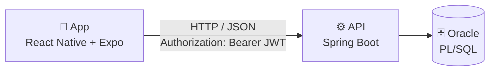

<div align="center">

# 🚨 AlertaBairro — App

**Rede comunitária de alerta e ajuda para eventos extremos — Global Solution 2026**

Moradores registram ocorrências (alagamento, árvore caída, falta de luz), encontram o abrigo com vaga mais próximo, pedem ou oferecem ajuda e avisam que estão bem com um toque.


</div>

---

## 📦 Repositórios do projeto

| Parte | Onde |
|---|---|
| **App mobile** (React Native + Expo + TypeScript) | este repositório — projeto em [`app/alertabairro`](app/alertabairro) |
| **API + banco Oracle** (Java Spring Boot, JWT, PL/SQL) | [bruneckel/alertabairro-api](https://github.com/bruneckel/alertabairro-api) |

Documentação detalhada do app: [`app/README_APP.txt`](app/README_APP.txt) · Links da entrega: [`links.txt`](links.txt)

## 🧭 Arquitetura



O app fala **só** com a API, por uma camada única em `src/servicos/api.ts`.

## 🚀 Como rodar

```bash
cd app/alertabairro
npm install
npx expo start
```

Abra no celular com o **Expo Go** (QR code) ou no emulador (`a` / `i`).

### Dados falsos x API real

| Modo | Como |
|---|---|
| **Mock** (padrão) | Sem variável de ambiente. Funciona sem API. Entre com um e-mail contendo `voluntario` para ver as ações de voluntário. |
| **API real** | Suba a API pelo [repositório do backend](https://github.com/bruneckel/alertabairro-api) e rode: |

```bash
EXPO_PUBLIC_API_URL=http://SEU_IP:8080 npx expo start
```

No PowerShell: `$env:EXPO_PUBLIC_API_URL="http://SEU_IP:8080"; npx expo start`

> Celular e computador na mesma rede Wi-Fi.

## 📱 Telas e funcionalidades

| Funcionalidade | Telas |
|---|---|
| Entrada | Início, Login, Cadastro |
| 1. Mapa e ocorrências | Mapa, Detalhe, NovaOcorrencia |
| 2. Abrigos, rota e SOS | Abrigos, Contatos de emergência |
| 3. Rede de ajuda e "estou bem" | Ajuda, NovoPedido |
| Conta | Perfil |

## 🔌 Rotas da API usadas

`POST /auth/login` · `POST /auth/cadastro` · `GET/POST /ocorrencias` · `PATCH/DELETE /ocorrencias/:id` · `GET /abrigos` · `GET /abrigos/proximo` · `PATCH /abrigos/:id/vagas` · `GET/POST /ajuda` · `PATCH/DELETE /ajuda/:id` · `POST /checkins`

## 🛠️ Dependências principais

Expo, React Native, React Navigation (native-stack e bottom-tabs), axios, react-native-maps, expo-location, expo-image-picker, expo-image-manipulator, AsyncStorage. Lista completa em [`app/alertabairro/package.json`](app/alertabairro/package.json).
